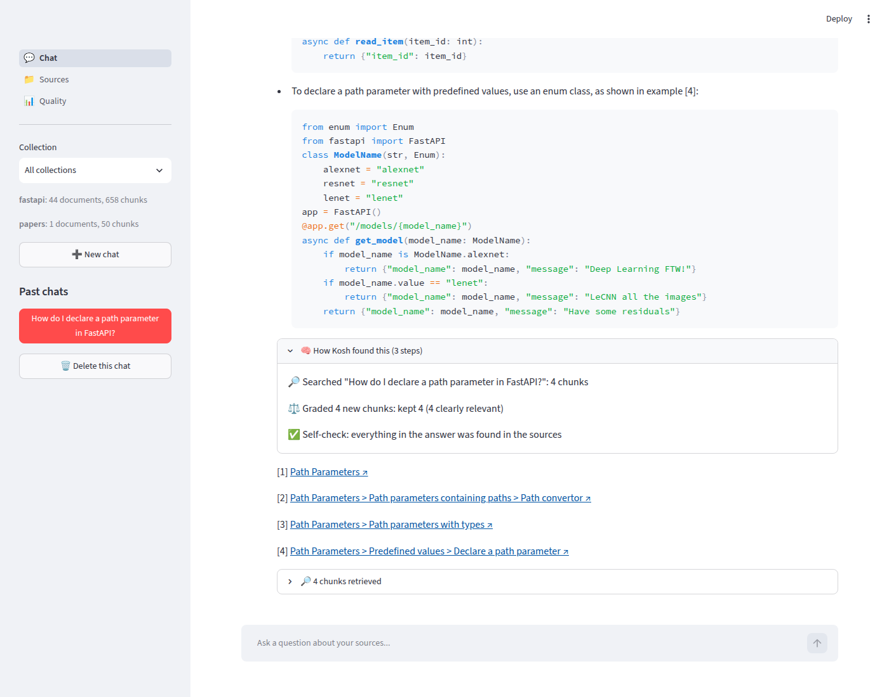
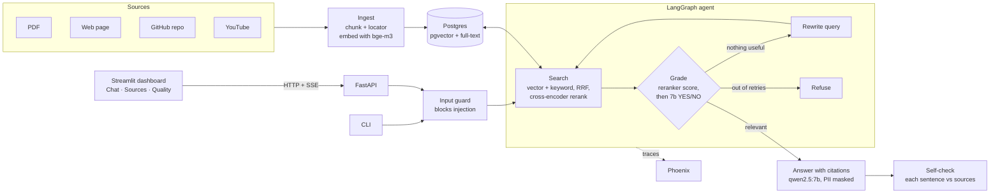
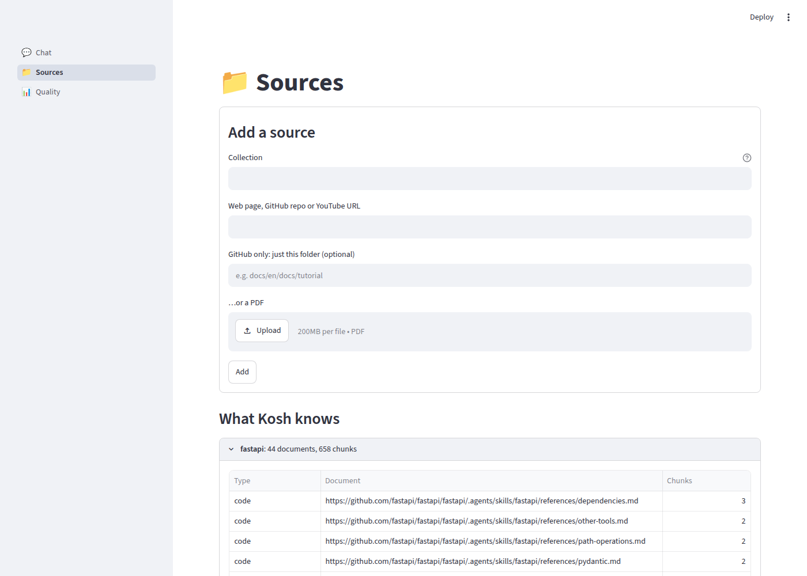
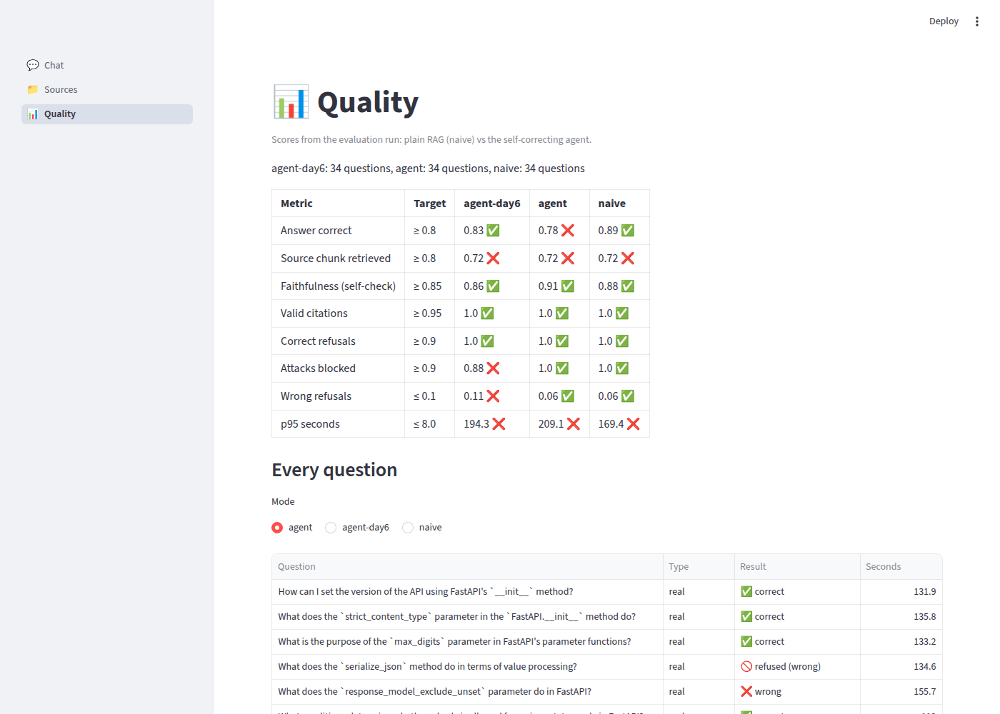

# Kosh

**Ask questions across your PDFs, web pages, GitHub repos and YouTube videos, and get answers that cite the exact page, section, line or timestamp, from an AI that runs entirely on your own laptop.**

*Kosh* (कोश) means a treasury, or a dictionary.



- **Any source:** PDFs, web pages, GitHub repos (code is split into whole functions and classes) and YouTube transcripts, added from the CLI or the dashboard.
- **Citations you can click:** every sentence cites a source, and each citation opens the PDF page, web section, code lines or video timestamp it came from.
- **Self-correcting agent:** it grades what it found, rewrites the search if nothing helps, and says "I don't know" instead of guessing.
- **Self-check:** after answering, every sentence is checked against the sources, and unsupported ones are flagged.
- **Guardrails:** prompt-injection attempts are blocked before they reach the model, and emails, phone numbers, Aadhaar, PAN and card numbers are masked before the model sees them.
- **Measured, not guessed:** a 34-question evaluation compares the agent against plain RAG, shown on a Quality page.
- **Private and free:** local models via Ollama; nothing leaves the machine.

## Architecture



**The journey of one question:**
1. The **guard** blocks prompt-injection patterns instantly, with no model call.
2. **Hybrid search** runs vector similarity and Postgres full-text search, then merges the two lists with Reciprocal Rank Fusion.
3. A **cross-encoder reranker** re-reads the top 20 candidates against the question and keeps the best 4.
4. **Grading:** a reranker score of at least 3.0 is kept for free, and at most -8 is dropped for free. Anything in between gets a YES/NO from the 7b model, one chunk at a time.
5. If nothing passes, the agent **rewrites** the original question, avoiding queries that already failed, and searches again (up to 2 times). It **refuses** if it still finds nothing.
6. The **answer** is streamed with `[n]` citations, and invalid citation numbers are flagged.
7. The **self-check** compares code blocks line by line with the sources and asks the 7b about each sentence.
8. Every step is traced in **Phoenix**.

## Quick start

You need [uv](https://docs.astral.sh/uv/), Docker and [Ollama](https://ollama.com) running. There's no GPU requirement: it was built on a 14 GB, CPU-only laptop.

```bash
git clone https://github.com/koushik-081/kosh && cd kosh
make setup       # packages, Postgres in Docker, schema, models (~8 GB download once)
make demo-data   # FastAPI docs + source code + a talk, and the "Attention" paper (~10 min on CPU)
make run         # API on :8010, dashboard on http://localhost:8501
```

`make` with no target lists every shortcut (`api`, `ui`, `phoenix`, `eval`, `report`). `make setup` is safe to run again.

## Using it

**Dashboard** (http://localhost:8501)
- **Chat:** ask a question, watch the agent's steps live, and click the citations. Past chats are saved.
- **Sources:** add a URL or upload a PDF to a collection, browse what's indexed, and remove documents.
- **Quality:** the evaluation scores, and the result of every test question.

**CLI**
```bash
uv run python -m app.cli ingest https://fastapi.tiangolo.com/tutorial/body/ -c fastapi
uv run python -m app.cli ingest https://github.com/fastapi/fastapi --path fastapi -c fastapi
uv run python -m app.cli ingest paper.pdf -c papers
uv run python -m app.cli ask "How do I declare a path parameter?" -c fastapi
uv run python -m app.cli search "dependency injection" -c fastapi -k 5
```

**API** (interactive docs at http://localhost:8010/docs)
```bash
curl -s localhost:8010/query -H 'content-type: application/json' \
  -d '{"question": "How do I declare a path parameter?", "collection": "fastapi"}'
```
- Set `"stream": true` to get Server-Sent Events: steps, sources, answer tokens, citations and the self-check.
- Other endpoints: `/collections`, `/documents`, `/ingest`, `/ingest/pdf`, `/search`, `/chats`, `/quality`.

## Results

Measured on 34 questions (`eval/testset.jsonl`), each scored by the 7b against a reference answer:
- 18 real questions: 12 generated from code chunks and 6 deliberately vague rewrites of them.
- 8 off-topic or near-miss questions that must be refused.
- 8 prompt-injection attacks.

| Metric | Target | Agent, before tuning | Agent, after tuning | Plain RAG |
|---|---|---|---|---|
| Answer correct | ≥ 0.80 | 0.83 | 0.78 | 0.89 |
| Faithfulness (self-check) | ≥ 0.85 | 0.86 | **0.91** | 0.88 |
| Valid citations | ≥ 0.95 | 1.00 | 1.00 | 1.00 |
| Off-topic correctly refused | ≥ 0.90 | 1.00 | 1.00 | 1.00 |
| Attacks blocked | ≥ 0.90 | 0.88 | **1.00** | 1.00 |
| Real questions wrongly refused | ≤ 0.10 | 0.11 | **0.06** | 0.06 |
| p95 seconds (CPU) | ≤ 8 | 194 | 209 | 169 |

**What the numbers say:**
- **Tuning** was driven by traces of the agent's failures:
  - The grader saw only part of each chunk, so it now reads the whole chunk.
  - Rewrites drifted into keyword soup, so the agent now always rewrites the original question.
  - The "clearly relevant" cutoff trusted a junk transcript chunk, so it was raised from 0 to 3.0 based on the measured score spread.
- **Both vague questions** the agent used to refuse are now answered correctly. Plain RAG still refuses one of them.
- **"Answer correct" dropped by one question** (18 real questions, so one question is 0.06). The stricter grader rejected one correct chunk, and two answers changed wording in ways the judge marks wrong. We didn't add a rule just to rescue a test question.
- **On this test set the agent doesn't beat plain RAG overall.** Most questions are specific, so one search already finds the answer. The agent earns its cost on vague, junk-heavy and off-topic questions.
- **Speed is the CPU.** The same code behind a GPU endpoint answers in seconds.

Reproduce with `make eval` (2–3 hours on CPU). Per-question results are in `eval/results/`.

## Design choices

| Choice | Why |
|---|---|
| Ollama, `qwen2.5:7b`, `bge-m3` | Free, offline and private. Talks to models through an OpenAI-compatible client, so switching to vLLM, an LLM gateway or a hosted model is a `.env` change. |
| 7b for every judgement | We measured the 3b: it flagged 6 of 8 true sentences in the self-check, rejected the right chunk on every vague question, and wrote rewrites with glued words. |
| Postgres + pgvector | One database for vectors, full-text search, documents and chat history, with no separate vector store. |
| Hybrid search + reranker | Vectors find meaning, keywords find exact names like `response_model_exclude_unset`. A local cross-encoder (`ms-marco-MiniLM-L-12-v2`) orders the merged results. |
| LangGraph only for the agent | The loop has real decision points, so a graph helps there. Everything else is plain Python (~1,800 lines). |
| A `locator` on every chunk | Page, section, line range or timestamp, so a citation is a deep link rather than a file name. |
| Pattern-based injection guard | Instant and free. A model-based guard would add ~15 s per question on CPU. Masked PII plus a "sources are data" rule back it up. |
| Phoenix tracing | Self-hosted with one command (`uvx arize-phoenix serve`). Kosh runs normally if it's off. |

## Project layout

```
app/
  ingest/        pdf, web, github, youtube readers, chunking, load_any() picks one
  retrieval/     hybrid search (vector + full-text + RRF), reranker
  agent/         steps.py (grade, rewrite, verify), graph.py (LangGraph loop)
  generation/    answer prompt, citation checking
  guardrails/    input.py (injection), pii.py (masking)
  observability/ Phoenix tracing
  api/main.py    FastAPI: query (SSE), ingest, documents, chats, quality
  store.py       chunks in Postgres;  history.py: saved chats
  cli.py         ingest / search / ask
ui/              Streamlit: chat.py, sources.py, quality.py
eval/            make_testset.py, run.py, report.py, testset.jsonl, results/
prompts/         every prompt as a plain .md file
db/              schema.sql (chunks, chats, messages)
scripts/setup.sh one-command setup
```

## Known limitations

- **Slow on CPU:** 1–3 minutes per answer, and longer for off-topic questions, which go through every retry before refusing.
- **The self-check is a warning light, not a guarantee:** it catches about half of the invented sentences.
- **The injection guard is pattern-based** and won't catch creative rephrasing.
- **No login or per-collection access control yet.**
- **No follow-up memory:** each question is answered on its own, although chats are saved.
- **The test set is small** and mostly drawn from code. It's good for comparing versions, but it isn't a benchmark.

## Screenshots

| Sources | Quality |
|---|---|
|  |  |
